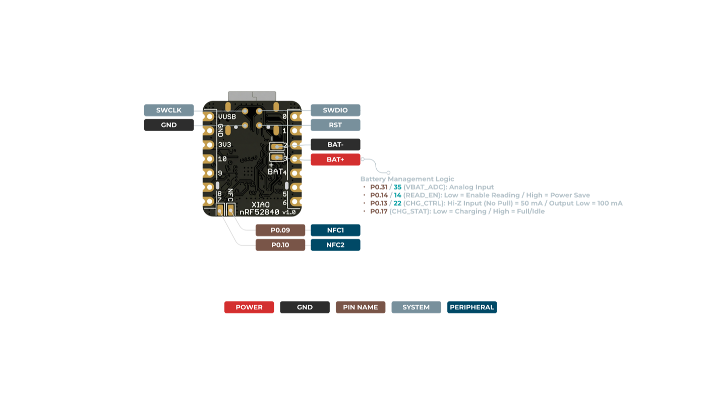
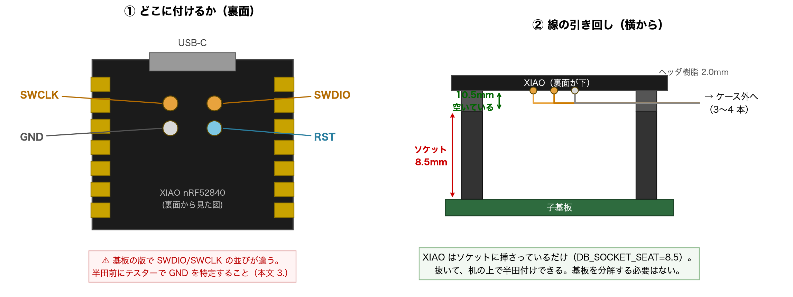

# SWD と RTT で、動いている実機の中を読む

**目的は「止まって人が確かめる」回数を減らすこと。**速さではない。
1 回のサイクルで利用者が手を出す箇所が何か所あるかを数える。

| 今まで | ここで変わるか |
|---|---|
| push → CI → `.uf2` を取る | **自動化できる**（`gh run download`） |
| リセット 2 度押し | 物理。→ SWD で消える（[6](#6-書き込みも-swd-から)） |
| `.uf2` をコピー | 自動化できる |
| 電源スイッチ・電池を整える | 物理。残る |
| **動かして確かめる** | **RTT で機械が読めるようになる**（この文書） |
| 結果を人が言葉で伝える | 同上 |

---

## 1. なぜ RTT か（USB のログとの違い）

ログの出口は**すでに 1 つある**。`build.yaml` の `zmk-usb-logging`
（`hhkb_split_right-pod-log` ほか）。だから「右は何も喋れない」は誤り。

違いは **USB を塞ぐかどうか**。

| | USB CDC（既存） | **RTT（これ）** |
|---|---|---|
| 配線 | USB ケーブル | SWD 2 本 + GND |
| USB ポート | **塞がる** | **空いたまま** |
| 電池だけで動かしている最中 | **見えない** | **見える** |
| BLE で繋がっている最中 | USB に挿すと条件が変わる | **そのまま見える** |
| 左右どちらでも | 右も snippet で可 | 可（`ZMK_USB` に依存しない） |

**効くのは「実際に使っている状態のまま読めること」。**
電池駆動・無線接続中という、いちばん知りたい条件を壊さない。

### 何が引かれるか（常用ファームにしないこと）

`CONFIG_ZMK_RTT_LOGGING=y` は ZMK 本体（`app/Kconfig`）で

```
select LOG / DEBUG / ASSERT / USE_SEGGER_RTT / CONSOLE / RTT_CONSOLE
```

を引く。**`DEBUG` と `ASSERT` が付く＝最適化とアサートの挙動が普段と変わる。**
タイミングに関わる調査（BLE の接続間隔など）では、**この差そのものが
結果を動かしうる**。比較するなら RTT 版どうしで揃える。

---

## 2. 配線（XIAO 裏面の 4 つのパッド）



出典: [Seeed Studio XIAO nRF52840 wiki](https://wiki.seeedstudio.com/XIAO_BLE/)
の `XIAO_nRF52840_Sense_back_pinout.png`。USB コネクタの直下に 2×2 で並ぶ。

```
        [ USB-C ]
   SWCLK ●    ● SWDIO      ← USB 側
    GND  ●    ● RST
```

> ⚠️ **基板の版で並びが違う。**同じ wiki の `SWD1.png`（"New version" と
> 書かれた実写）は **SWDIO が上・SWCLK が下**で、上の図と逆に見える。
> **半田付けの前に、自分の基板のシルクを読むこと。**取り違えても壊れないが
> 繋がらない。判断に迷ったら、通電せずにテスターで
> [3 の導通確認](#3-繋ぐ前に-1-分で確かめる)をする。

**繋ぐのは 3 本**（SWDIO / SWCLK / GND）。RST は無くても RTT は読める。



### 分解は要らない（XIAO は抜ける）

**いまはソケット式**（`DB_SOCKET_SEAT = 8.5`・[envelopes.py:286](../../tools/envelopes.py#L286)
「プロトタイプ限定」）。XIAO は挿さっているだけなので、

> **抜いて、机の上で半田付けして、挿し直す。**

隙間は `8.5 + 2.0 = 10.5mm` あり、線を逃がす余裕も十分ある。
（直付けに移行したあとは 2.0mm になるので、そのときは話が変わる）

### 線の仕様

| | 推奨 | なぜ |
|---|---|---|
| 太さ | **AWG30（φ0.25 前後）の単線**。ジュンフロン線・ラッピング線 | パッドが小さいので細いほうが付けやすい。単線は形が保てるので取り回しが楽 |
| 長さ | **15〜20cm** | ケースの外まで出して、机の上の Pico に届く。長すぎると SWD の波形が鈍る（1m を超えなければ実用上問題ない） |
| 反対側 | **メス**（デュポン線のメス） | **手持ちの Pico は H / WH でオスピンが立っている。**そこへ被せるのでメス |
| 色 | 3〜4 色に分ける | GND を黒にしておくと、挿し間違いが減る |

いちばん簡単なのは、**デュポン線（オス-メス）のオス側を切り落として、
その切り口を XIAO のパッドに半田付けする**こと。反対側はメスのまま
Pico H のピンに挿さる。線を自作しなくてよい。

> ⚠️ **Pico の型で変わる。**ヘッダの無い素の Pico を使うなら逆（反対側は
> オス、または Pico 側にもピンを立てる）。**この案件の手持ちは Pico H ×2 と
> Pico WH ×1 で、いずれもオスピンが実装済み**（2026-10-14・利用者）。

> **線の固定を忘れないこと。**パッドの半田は引っ張りに弱い。
> 線が動かないよう、XIAO の縁か子基板側にテープか接着剤で 1 か所留める。
> （[fab-checklist §8d](../hardware/fab-checklist.md) の「組立時にリード線を
> ケース側で固定」と同じ考え方）

- パッドは**丸い裸のランドで、狭くない**。2.54mm ヘッダのパッドと同程度
- **XIAO はソケットに挿さっているだけ**（`DB_SOCKET_SEAT = 8.5`・プロトタイプ
  限定）。**抜いて机の上で作業できる**ので、基板の分解は要らない
- 子基板との隙間は **8.5 + 2.0 = 10.5mm**。線を逃がす余地は十分
- **XIAO の頭上に本体基板は無い**（XIAO 前端 y≈50.8 / 基板後端 y=48.95・
  [open-gaps](../hardware/open-gaps.md)）。上からのアクセスは塞がれていない

### 覚悟しておくこと

**これは「動いている実機」への不可逆な改造**になる。

1. **似た却下があるが、これには当てはまらない。**
   [open-gaps](../hardware/open-gaps.md) の「XIAO 裏面の NFC パッドを GPIO 化」
   は利用者が却下している（理由:「裏面に線が付くと、ソケット式のまま／
   直付けへの変更のどちらも塞ぐ」）。**だが文脈が違う。**

   | | NFC 案（却下） | SWD（これ） |
   |---|---|---|
   | 用途 | **製品の機能**（PMW3610 の MOTION を常時） | **開発のとき読むだけ** |
   | 寿命 | 恒久。出荷する全台に必要 | 外せる。開発機だけ |
   | 出荷構成への影響 | **ソケット／直付けの判断を先に固定する** | 参加しない |

   開発用の線は出荷構成の判断に関わらないので、**この却下は効かない。**
   残る実害は「線が付いている個体は抜き差ししづらい」だけ。
2. **挿抜で引っ張られると断線する。**隙間に逃がし、
   線は子基板側で固定する（子基板の線ランドと同じ考え方＝
   [fab-checklist §8d](../hardware/fab-checklist.md)「組立時にリード線を
   ケース側で固定」）。
3. **左右を同時にやらない。右から。**右（ペリフェラル）は USB を挿さないと
   喋れないので、RTT の利得が最も大きい。片方で通してから左へ。

---

## 3. 繋ぐ前に 1 分で確かめる

半田付けの前に、**どのパッドが SWDIO / SWCLK か**を自分の基板で確める。

```
テスターの導通で:
  GND のパッド ── XIAO の GND ピン（ヘッダ側）が導通する
     → そのパッドが GND。残り 3 つの向きが決まる
```

これで版の違い（上の ⚠️）を回避できる。**シルクと実測の 2 つで一致を見る**
——ピン配置は独立した複数の視点で確かめる、というこの案件の作法
（[fab-checklist](../hardware/fab-checklist.md) のピン対応の節）。

---

## 4. Pico を debugprobe にする

**半田不要。`.uf2` をコピーするだけ。**

1. [raspberrypi/debugprobe のリリース](https://github.com/raspberrypi/debugprobe/releases)
   から **`debugprobe_on_pico.uf2`** を取る

   > ⚠️ **`debugprobe.uf2` と間違えないこと。**同じリリースに両方ある
   > （v2.3.1 で確認）。
   >
   > | ファイル | 対象 |
   > |---|---|
   > | `debugprobe.uf2` | **公式の Debug Probe 製品**（別のハード） |
   > | **`debugprobe_on_pico.uf2`** | **Pico をプローブとして使う** ← これ |
   > | `debugprobe_on_pico2.uf2` | Pico 2 |
   >
   > **Pico H は Pico と同じ RP2040 基板**（違いはヘッダと 3 ピンの
   > デバッグコネクタだけ）なので `_on_pico` でよい。
2. Pico の BOOTSEL を押しながら USB に挿す → `RPI-RP2` がマウントされる
3. `.uf2` をコピー

**Pico 側の配線**。出典は debugprobe の
[`include/board_pico_config.h`](https://github.com/raspberrypi/debugprobe/blob/master/include/board_pico_config.h)
（ソースで確認。wiki ではなく定義そのもの）:

| Pico | → | XIAO | 要るか |
|---|---|---|---|
| **GP2** | → | **SWCLK** | 必須 |
| **GP3** | → | **SWDIO** | 必須 |
| **GND** | → | **GND** | 必須 |
| GP1 | → | RST | 任意。**あると「リセット 2 度押し」が完全に消える** |
| GP4 (TX) | → | — | 任意。UART を使うなら（RTT を使うので今回は不要） |

```c
/* board_pico_config.h より */
#define PROBE_PIN_SWCLK (PROBE_PIN_OFFSET + 0) // 2
#define PROBE_PIN_SWDIO (PROBE_PIN_OFFSET + 1) // 3
#define PROBE_PIN_RESET 1
```

> **GP1 → RST は付けておくことを勧める。**XIAO のリセットボタンは
> 組むと押せない（上を向いており、真上に本体基板が来る。だから
> `Fn+Ctrl+Esc` をブートローダ用に割り当ててある）。
> **プローブからリセットできれば、その物理作業ごと無くなる。**

> ⚠️ **Pico H の 3 ピンのデバッグコネクタは使わない。**あれは
> 「**その Pico 自身がデバッグされる**」ための口（SWDIO/GND/SWCLK を
> 外に出す）。今回は逆に Pico が**デバッグする側**なので、使うのは
> 上の表の普通の GPIO。
> （[公式](https://www.raspberrypi.com/documentation/microcontrollers/pico-series.html):
> 3 ピンは "for programming and debugging the board's microcontroller"）

> **Nucleo F401RE でも代用できる**（オンボードの ST-LINK）。ただし RTT は
> `probe-rs` + CMSIS-DAP の組み合わせがいちばん素直なので、Pico を勧める。
> Pico は 2 個あるので 1 個を debugprobe に占有してよい。

---

## 5. 読む

```bash
# probe-rs（CMSIS-DAP を直接しゃべる。J-Link のソフトは要らない）
# debugprobe は CMSIS-DAP なので、probe-rs がそのまま認識する
# （probe.rs「All probes implementing this standard are supported」）。
# macOS はドライバ不要。
cargo install probe-rs-tools        # もしくは公式のインストーラ

probe-rs list                        # ① プローブが見えるか
probe-rs chip list | grep -i 52840   # ② 正しいチップ名を確かめる
probe-rs attach --chip <①②で確かめた名前> --rtt-scan-memory
```

> ⚠️ **チップ名は実行して確かめること。**`nRF52840_xxAA` のはずだが、
> **手元に probe-rs を入れていないので未確認**。`chip list` の出力が正。

焼くのは `build.yaml` の RTT 版:

- `hhkb_split_right-pod-rtt`
- `hhkb_split_left-podR-encB-rtt`

### 何が読めるか

いまファームが出しているもの（抜粋）:

- `low_battery_off.c` … 打ち止めの判定・USB 給電の門・soft off に入る瞬間
- `status_led.c` … リンクの状態遷移（未ボンド / 未接続 / 接続）
- ZMK 本体 … BLE の接続間隔、`hog.c` の notify 失敗、分割の接続

**2026-09-26 の右手の soft off は、これがあれば 1 行で終わっていた。**
（USB 給電中に打ち止めと誤判定していたが、右は何も喋れなかったので
原因の特定に往復した。[open-gaps #25b](../hardware/open-gaps.md)）

---

## 6. 書き込みも SWD から

RTT が通れば、同じ線で書き込みもできる。**リセット 2 度押しが消える。**

```bash
probe-rs download --chip nRF52840_xxAA --binary-format uf2 <file>.uf2
```

> ⚠️ **ブートローダを消さないこと。**`--chip-erase` を付けると UF2
> ブートローダごと消える。そうなると USB での書き込みができなくなり、
> 復旧は SWD からしかできなくなる（[xiao-flash-recovery.md](../hardware/xiao-flash-recovery.md)）。

---

## 7. どこまで確かめたか

**実機では 1 度も通していない。**機械で確かめられたのはここまで:

- [x] **`CONFIG_ZMK_RTT_LOGGING=y` で CI のビルドが通る**
      （2026-10-14・run 38574345395・左右とも success）
- [x] **`.uf2` が実際に出来ている**（`hhkb_split_right-pod-rtt.uf2` /
      `hhkb_split_left-podR-encB-rtt.uf2`。出来た物を見て確認）
- [x] **DEBUG/ASSERT のぶん太っている**——右の中身が
      **213,504 → 349,952 バイト（+64%）**。「常用ファームにしない」は
      推測ではなく実測。
- [x] debugprobe のピン（GP2=SWCLK / GP3=SWDIO / GP1=RESET）を
      [ソースの定義](https://github.com/raspberrypi/debugprobe/blob/master/include/board_pico_config.h)で確認
- [x] 裏面パッドの位置を Seeed の公式図で確認（ただし版の差あり→[2](#2-配線xiao-裏面の-4-つのパッド)）

**残っているもの（実機が要る）:**

- [ ] 焼いた実機から実際に RTT が読めるか ← **次の一手**
- [ ] probe-rs のチップ名（`nRF52840_xxAA` のはず・未検証）
- [ ] 自分の基板の SWDIO/SWCLK の並びが、公式図と同じか
- [ ] `DEBUG`/`ASSERT` で BLE のタイミングが変わらないか
- [ ] 2.0mm の隙間に線を逃がして、挿抜に耐えるか
