# 量産の手順書（スティックとエンコーダの増設・1 組ぶん）

2026-10-18 版。2 組目のキーボードで実際に組んで動いた手順を、**最短の形**にまとめた物。
図と細かい理由は [guide/GUIDE.md](guide/GUIDE.md)（図つきの最初の手順書）にある。ここでは「何をどの順に」だけを書く。

**この版で変えた所: プレートと台座を一体にした**（受け皿が要らない）。一体型は 2 組目では使っていない。初めて刷る形。

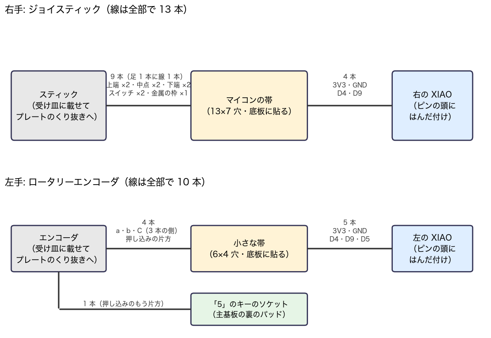

左手の「小さな帯」は、量産では使わない（エンコーダから XIAO へ直接つなぐ。3 章）。

---

## 0. 1 組に要る物

### 秋月で買う物
| 品 | 品番 | 1 組で使う数 |
|---|---|---|
| ジョイスティック RKJXV122400R | g115951 | 1 |
| ロータリーエンコーダ（2 色 LED・スイッチ付・つまみ付） | g105770 | 1 |
| ATTINY1616 DIP 化キット | g130229 | 1 |
| ユニバーサル基板 D タイプ（**厚さ 1.0mm**・片面） | g112019 | 右の帯 1 枚ぶん（13×7 穴。1 枚から 2 組取れる） |
| ショットキーダイオード BAT43 | g113907 | 2（左の押し込み 1・書き込み用 1。書き込み用は使い回せる） |
| 抵抗（**小型に限る**） 33Ω／330Ω／1kΩ／6.8kΩ | g108517／g116331／g116102／g116682 | 1／2／3／2 |
| コンデンサ 10µF（**高さ 6mm 以下**）／0.1µF／100pF | g116018／g113582／g104061 | 1／1／2 |
| 耐熱電子ワイヤ AWG28 相当 10 色 | g111640 | 約 2m |

左の帯（100kΩ の抵抗）は**要らない**。左はエンコーダから XIAO へ直接つなぐ。

### 手持ちで使う物
- USB シリアル変換器 FT232R（信号 3.3V）と、**単 3 電池 2 本の電池ボックス**（マイコンへの書き込み用）
- テスター、はんだごて、ボンド（爪を留める）、スポンジ入りの両面テープ（帯を貼る）

### 刷る物（A1 mini・0.4mm ノズル。3MF は `build/joystick/mass/`）
| 部品 | 3MF | 時間 |
|---|---|---|
| 左プレート（台座一体） | `joystick_2_left_plate_seat.3mf` | 約 49 分 |
| 右プレート（台座一体） | `joystick_3_right_plate_seat.3mf` | 約 59 分 |
| スティックの頭 | `joystick_10_round_stop_heads.3mf` の **使う方 1 個** | 約 20 分（2 個のとき） |
| エンコーダのつまみ（まっすぐ・穴 6.05） | `joystick_11_knob_straight.3mf` | 約 27 分 |

---

## 1. 刷る（どれも上面をベッドへ）

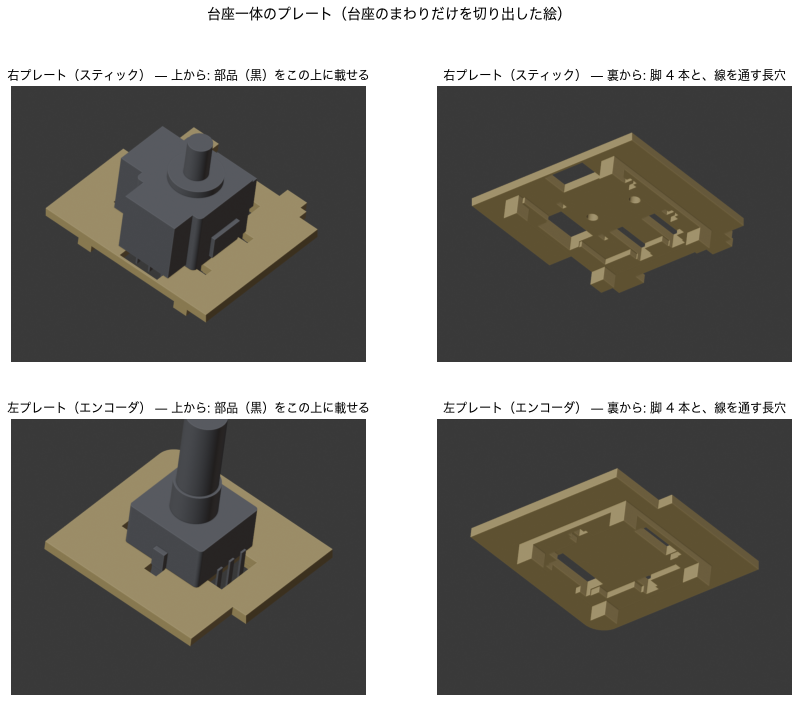
- [ ] 左右のプレート（台座一体）
- [ ] スティックの頭・つまみ

---

## 2. 右手（スティック）

### 2-1 部品の確認（テスター）
- [ ] スティック: P1–P3・Q1–Q3 が約 10kΩ／押すとつながるのは S1–S3（S2–S4）／爪はどこともつながらない

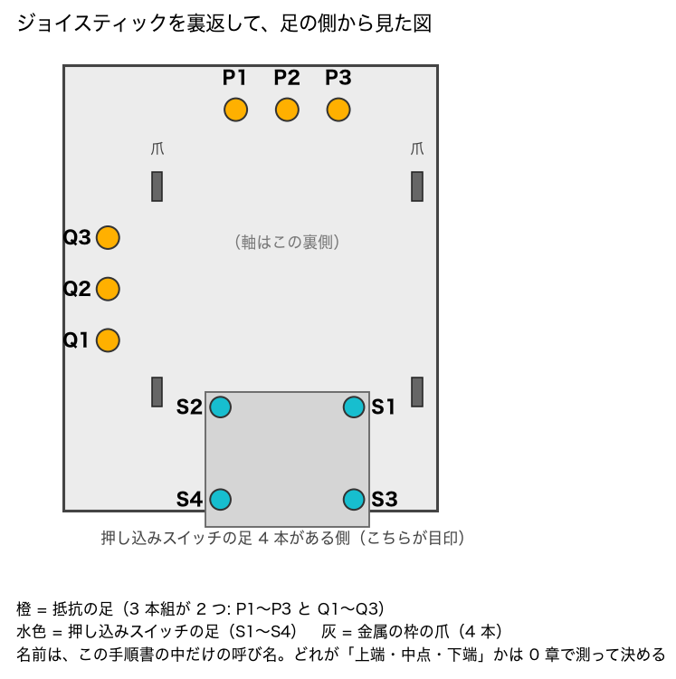


### 2-2 マイコンに書く（帯に載せる前）
- [ ] キットにピンヘッダをはんだ付け
- [ ] ブレッドボードでつなぐ: 変換器 RX → キット RST、TX → BAT43（**黒い帯を TX 側**）→ RX の線、GND どうし。**電源は単 3 × 2 本の ＋ を VDD へ**（変換器の VCC＝5V はつながない）

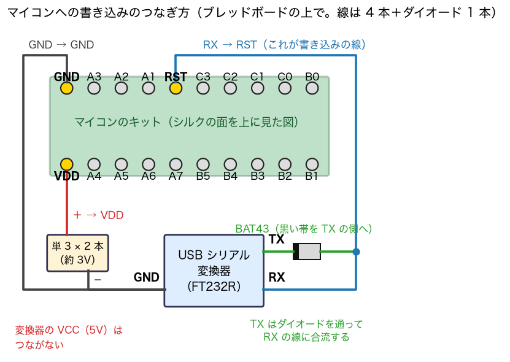

- [ ] 書く（`pod_layout/pod_incase.hex`）:
  ```
  pymcuprog ping  -t uart -u /dev/cu.usbserial-XXXX -d attiny1616 -c 57600           # ID 1E9421 が返る
  pymcuprog write -t uart -u … -d attiny1616 -c 57600 -f pod_incase.hex --erase --verify
  pymcuprog write -t uart -u … -d attiny1616 -m fuses -o 0 -l 0x0B
  pymcuprog write -t uart -u … -d attiny1616 -m fuses -o 1 -l 0x08
  pymcuprog write -t uart -u … -d attiny1616 -m fuses -o 2 -l 0x02
  pymcuprog read  -t uart -u … -d attiny1616 -m fuses                                   # 0B 08 02 …
  ```
  **SYSCFG0（オフセット 5）は書かない**（戻せなくなる）

### 2-3 帯を作る
- [ ] 基板を 13×7 穴に切る（14×8 のままでも入る）。被覆のジャンパ線を行 2 の列 1 → 列 11

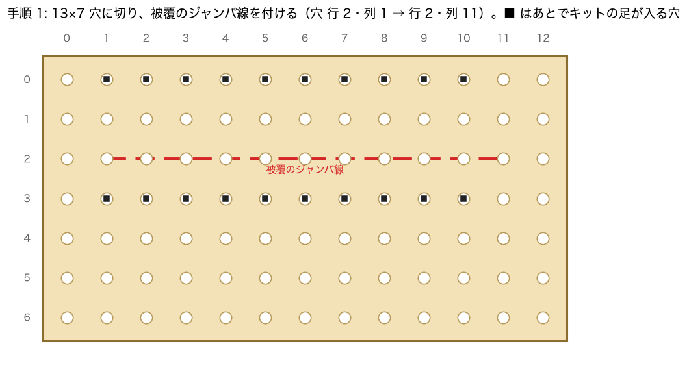

- [ ] 抵抗 8 本・コンデンサ 4 個

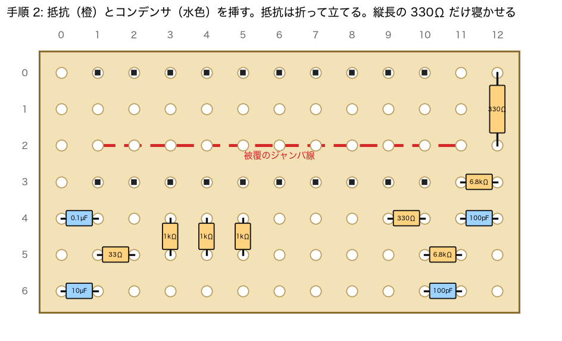

- [ ] **キットを先に載せる**: GND が列 1・行 0、VDD が列 1・行 3
- [ ] 裏のはんだの橋。**線を挿す 13 か所の穴へ行く最後の 1 区間は、まだつながない**（穴を埋めると線が入らない）

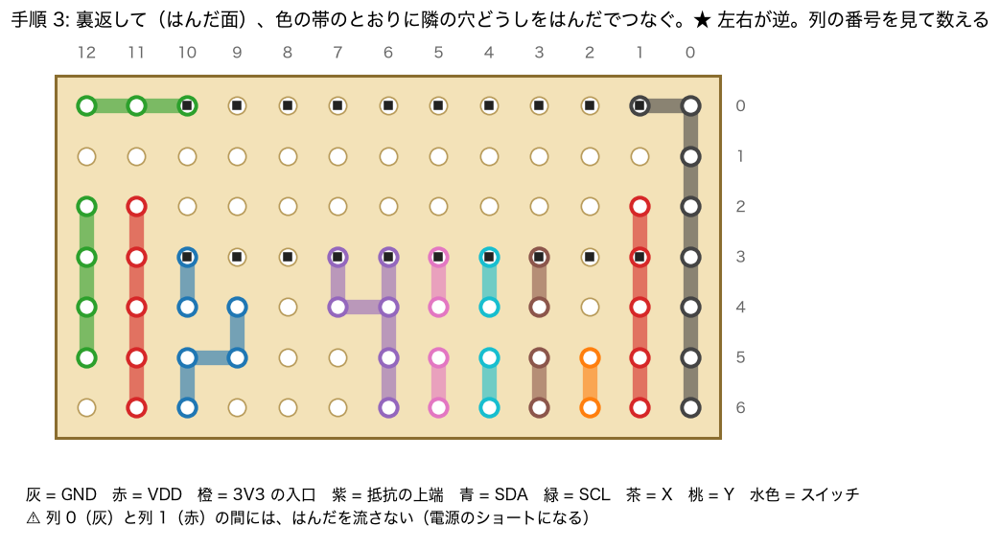

- [ ] テスター `200`: 列 0（GND）と列 1 の行 3（VDD）が `0` 付近**でない**こと

### 2-4 スティックに線を付けて、プレートに載せる
- [ ] 足 1 本に線 1 本（各 15cm・350℃・3 秒以内）。色の決まり:

| 足 | P1 | P2 | P3 | Q1 | Q2 | Q3 | S1 | S3 | 爪（縁まで切り欠いてある側） |
|---|---|---|---|---|---|---|---|---|---|
| 色 | 橙 | 白 | 茶 | 紫 | 灰 | 青 | 黄 | 緑 | 黒 |

どの足がどこか、線をどの穴へ挿すかは、この図（足の側から見た向き）:

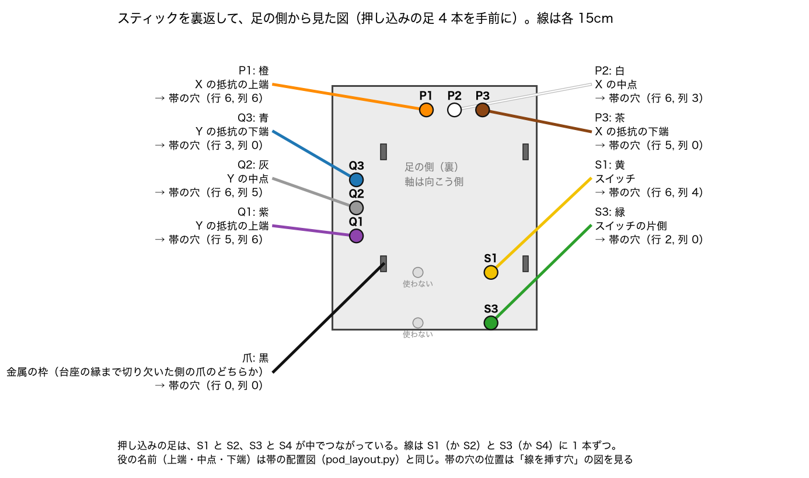

- [ ] **プレートの上から**スティックを台座に載せ、線を台座の長穴から下へ通す（1 章の絵の右上）
- [ ] **爪は曲げない**（曲がらない。基板にはんだ付けする端子）。留めるのは 2-6 で動いてから

### 2-5 帯と XIAO につなぐ
- [ ] スティックの 9 本を帯の緑の穴へ（穴の番号は 2-4 の図）。**挿した穴と隣の橋を、ここでつなぐ**

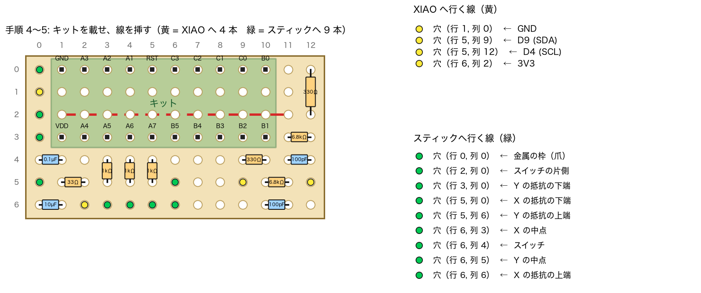

- [ ] 帯から XIAO へ 4 本（各 8cm）: 赤 → 3V3、黒 → GND、黄 → D4、緑 → D9。**XIAO の表面（金属のふたの面）のピンの頭**に

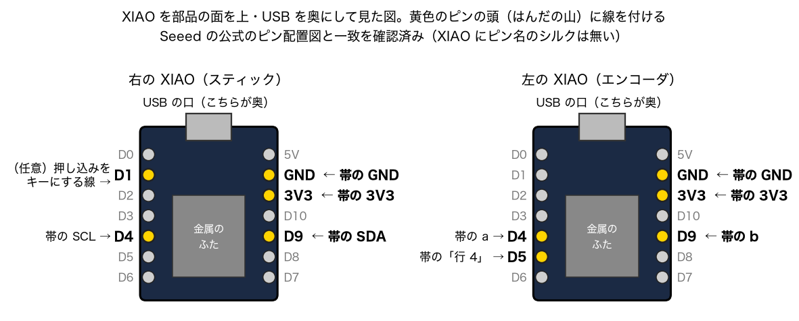

  - XIAO にピン名のシルクは無い。**USB の口の金属枠と「右の列・奥から 2 番め」が導通 = GND** で向きを確かめる

### 2-6 机で動かしてから固定
- [ ] **XIAO を子基板のソケットに挿す**（挿さないとキーが効かない）
- [ ] ファームを書く（4 章）→ 倒すと動く・押すと左クリック・左 Ctrl＋押すと右クリック
- [ ] 動いたら、**爪の根元を裏からボンドで留める**（さらさらの瞬間接着剤は中へ染みるので不可）

---

## 3. 左手（エンコーダ）

### 3-1 部品の確認（テスター `200`）
- [ ] 3 本の側: 止まった所で外 2 本とも開き、刻みの間で一瞬つながる。4 本の側の**両端**: 押すとつながる

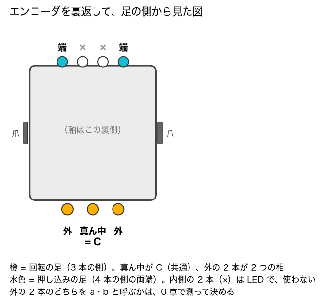


### 3-2 線を付けて、プレートに載せる（帯は使わない）
- [ ] **置き方**: 足を自分に向け、3 本の列を手前・4 本の列を奥。この向きで:

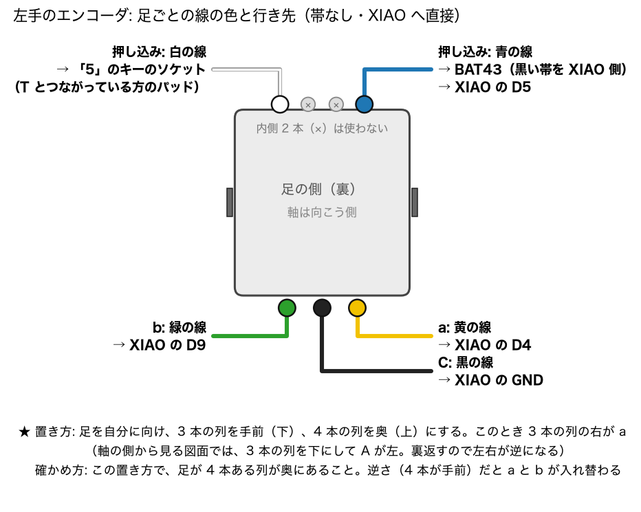


| 足 | 色 | 行き先 | 長さ |
|---|---|---|---|
| 3 本の列の右（a） | 黄 | XIAO の D4（左の列・奥から 5 番め） | 8cm |
| 3 本の列の真ん中（C） | 黒 | XIAO の GND（右の列・奥から 2 番め） | 8cm |
| 3 本の列の左（b） | 緑 | XIAO の D9（右の列・奥から 5 番め） | 8cm |
| 4 本の列の端の片方 | 青 | BAT43（**黒い帯を XIAO 側**）→ XIAO の **D5（左の列・奥から 6 番め）** | 8cm |
| 4 本の列のもう片方の端 | 白 | 主基板の裏・「5」のソケットの、**T のソケットとつながっている方**のパッド | 12cm |

- [ ] ⚠️ **D5 を D3（奥から 4 番め）と取り違えない**（2 組目でやった。押すと「5」が入力される）
- [ ] プレートの上から台座に載せ、線を下へ通す。爪は曲げない

### 3-3 机で動かしてから固定
- [ ] 回すとホイール・押すと中クリック・Fn＋回すと拡大縮小
- [ ] 動いたら爪の根元をボンドで留める。**つまみは最後**（筐体に入れて動作を見てから）

---

## 4. ファームを書く

| 側 | ファイル | 書き込みモードへの入り方 |
|---|---|---|
| 右 | `hhkb_split_right-pod.uf2` | 初回はリセット 2 回押し。2 回め以降は **Fn ＋ 左 Ctrl ＋ 6** |
| 左 | `hhkb_split_left-podR-encB-win.uf2`（Windows の面で起動）／`hhkb_split_left-podR-encB.uf2`（Mac の面で起動） | 初回はリセット 2 回押し。2 回め以降は **Fn ＋ 左 Ctrl ＋ Esc** |

GitHub の Actions → `Build ZMK firmware`（main）の成果物から取る。`XIAO-SENSE` のドライブに .uf2 をコピーする（コピー後のエラー表示は正常）。
**新しい左右が初めてつながるまで、ほかのキーボードの電源は切っておく**（片割れどうしが混線する）。

---

## 5. 筐体に組む
- [ ] スイッチを全部、一体型プレートへ移す
- [ ] 線を主基板の上（スイッチの間）を奥へ通し、主基板をスイッチの足へ戻す。**右端まで奥まで押し込む**（2 組目で右端の 5 キーが効かなかった）
- [ ] 線は主基板の奥の縁、XIAO のソケットの脇（幅 約 1.8mm）で**縦 1 列**にして下へ

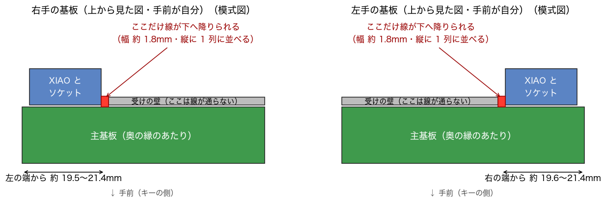

- [ ] 右の帯を、スポンジ入りの両面テープで底板に貼る。スティック → 帯の線に 3cm のたるみ
- [ ] 底板を閉じる。スティックの頭を**奥まで**押し込む（浮いていると、倒しきったとき戻らない）。最後につまみ

## 6. 最後の確認
- [ ] 全キー（特に右端の \ ` BS Enter Fn）
- [ ] スティック: 向き・速さ・左 Ctrl で遅く・Fn でスクロール・倒しきって離すと戻る
- [ ] エンコーダ: 回す・押す・Fn＋押す（右クリック）

---

## まだ決まっていない・確かめていない所
- **一体型プレート**: 計算と形の検査（受け皿＋くり抜きプレートとの差が、隙間を埋めた所と穴の延長だけ）と、スライスまで。**実物では未確認**
- **スティックの頭**: `round_low_stop`（根元 半径 3.4）と `_thick`（半径 4.2）のどちらを使っているか、この版には書いていない
- **Bluetooth のカクつき対策（版 E・F）**: 作業用のブランチ `ble-jitter-trial` にあり、main のファームには入っていない
